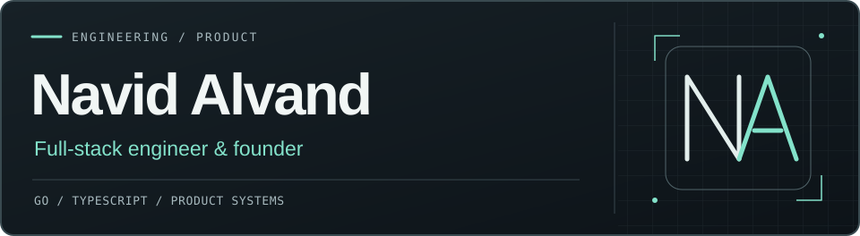

I build software products from the first API and data model to the interface, deployment and production operations. My background is in backend engineering; my work extends across the full stack, with a focus on making complex systems straightforward to use and maintain.

[**Vaghty**](https://vaghty.com) &nbsp;·&nbsp; [LinkedIn](https://www.linkedin.com/in/navidalvand/) &nbsp;·&nbsp; [X](https://x.com/navidalvand)

## 01 / Building

### [Vaghty — وقتی](https://vaghty.com)

**Founder · Full-stack engineer**

An appointment-booking platform for service businesses. I'm building the product and its underlying engineering systems, from booking flows and business management to the web experience and operational tooling.

**Go · Next.js · TypeScript · PostgreSQL · Redis · Docker**

### [Joow](https://joow.ir)

Previous engineering work on a messaging product. My work covered backend APIs, real-time communication, background processing, authentication and notification systems.

**NestJS · TypeScript · Prisma · PostgreSQL · Redis · Socket.IO**

## 02 / Engineering

| Discipline | Tools & technologies |
| :--- | :--- |
| **Backend & APIs** | Go, Node.js, TypeScript, NestJS, Express, Fastify, REST, OpenAPI |
| **Web & mobile** | React, Next.js, Tailwind CSS, Flutter |
| **Data & identity** | PostgreSQL, MongoDB, Redis, Prisma, TypeORM, Keycloak |
| **Real-time & async** | WebSockets, Socket.IO, WebRTC, BullMQ |
| **Infrastructure** | Linux, Docker, Nginx, CI/CD, OpenTelemetry |
| **Applied AI** | LLM integrations, agent frameworks, MCP, retrieval-augmented generation, Qdrant |

Go and TypeScript are my primary tools. I choose the rest based on the problem rather than the stack.

## 03 / Public code

A selection of earlier public repositories, covering API development and server-side fundamentals. Much of my more recent product work lives in private repositories.

| Repository | Focus |
| :--- | :--- |
| [Project Manager](https://github.com/navidalvand/Project-Manager) | Project management API with Express, MongoDB and JWT |
| [Store Project](https://github.com/navidalvand/store-project) | Commerce-oriented backend with authentication, Redis and validation |
| [URL Shortener](https://github.com/navidalvand/urlshorter) | URL service using Express, MongoDB and Redis |
| [Nest Todo](https://github.com/navidalvand/nest-todo) | Modular NestJS API with MongoDB and authentication |
| [Express Cluster](https://github.com/navidalvand/express-cluster) | Node.js clustering and load-testing experiments |

[Explore all public repositories →](https://github.com/navidalvand?tab=repositories)

## 04 / How I work

I care about clear system boundaries, predictable state, useful tests, and software that can be operated after it ships. As a founder, I also care about whether the product solves a real problem — not just whether the architecture is interesting.

I'm particularly interested in backend architecture, real-time products, applied AI and the intersection of software engineering and product development.

---

**Let's connect.** [LinkedIn](https://www.linkedin.com/in/navidalvand/) · [X](https://x.com/navidalvand) · [GitHub](https://github.com/navidalvand)
