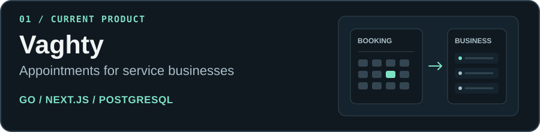
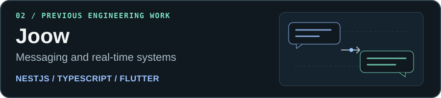
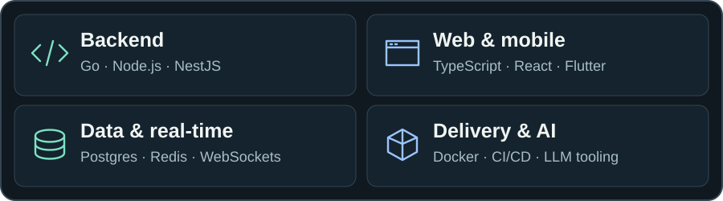

I build products across the full stack, with a backend-first approach. I work on the data model, API, interface and infrastructure, and stay involved when the software reaches production.

[**Vaghty ↗**](https://vaghty.com) &nbsp;·&nbsp; [LinkedIn ↗](https://www.linkedin.com/in/navidalvand/) &nbsp;·&nbsp; [X ↗](https://x.com/navidalvand) &nbsp;·&nbsp; [Public code ↗](https://github.com/navidalvand?tab=repositories)

---

## 01 / Selected work

**Founder & full-stack engineer · [vaghty.com](https://vaghty.com)**

An appointment-booking product for service businesses. I work across the booking experience, backend services, business and operator tooling, and deployment. The product brings together scheduling, customer-facing interfaces and operational workflows.

`Go` `Next.js` `TypeScript` `PostgreSQL` `Redis` `Docker`

**Previous engineering work · [joow.ir](https://joow.ir)**

Messaging infrastructure, backend APIs, real-time communication, authentication, background jobs and notification systems. The work spans a NestJS backend and a cross-platform Flutter application.

`NestJS` `TypeScript` `Prisma` `PostgreSQL` `Redis` `Socket.IO` `Flutter`

## 02 / Engineering toolkit

Go and TypeScript are my primary tools. I use Node.js for service-oriented applications, Go for backend systems, and React or Next.js for the web.

<b>Explore the broader stack</b>

| Area | Tools and practices |
| :--- | :--- |
| Backend & APIs | Go, Node.js, NestJS, Express, Fastify, REST, OpenAPI, gRPC |
| Frontend & mobile | TypeScript, JavaScript, React, Next.js, Tailwind CSS, Flutter |
| Data & identity | PostgreSQL, MongoDB, Redis, Prisma, TypeORM, Keycloak |
| Real-time & async | WebSockets, Socket.IO, WebRTC, BullMQ, event-driven workflows |
| Infrastructure | Linux, Docker, Nginx, CI/CD, OpenTelemetry |
| Applied AI | LLM integrations, agent frameworks, MCP, RAG, Qdrant |

## 03 / Public code

Selected earlier repositories. My newer product engineering is largely private; these projects show the foundations behind it.

| Repository | What it explores |
| :--- | :--- |
| [Project Manager ↗](https://github.com/navidalvand/Project-Manager) | Express API, MongoDB, JWT, OpenAPI |
| [Store Project ↗](https://github.com/navidalvand/store-project) | Commerce backend, authentication, validation, Redis |
| [URL Shortener ↗](https://github.com/navidalvand/urlshorter) | Express service, MongoDB, Redis |
| [Nest Todo ↗](https://github.com/navidalvand/nest-todo) | Modular NestJS API, authentication, MongoDB |
| [Express Cluster ↗](https://github.com/navidalvand/express-cluster) | Node.js clustering and load-testing experiments |

[Browse all repositories →](https://github.com/navidalvand?tab=repositories)

## 04 / How I work

I care about the parts of software that are easy to overlook: predictable state, useful tests, clear boundaries, and systems that can be operated after they ship. As a founder, I also care about whether the product solves a real problem.

<b>Areas I am exploring</b>

- Reliable service architecture, event-driven systems and real-time products.
- Applied AI: retrieval, agents and integrating models into existing products.
- Product design, developer experience, infrastructure and operational reliability.

---

**Find me:** [GitHub](https://github.com/navidalvand) · [LinkedIn](https://www.linkedin.com/in/navidalvand/) · [X](https://x.com/navidalvand) · [Vaghty](https://vaghty.com)
